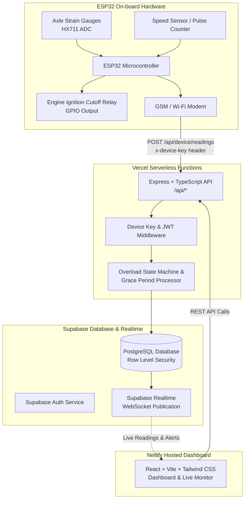

# OverloadGuard 🚛⚖️
### Cloud Telemetry & Automated Engine Relay Cutoff Dashboard for Goods Vehicles

**OverloadGuard** is a full-stack IoT monitoring and enforcement cloud platform engineered for Vehicle Overload Management Systems. It receives real-time axle strain-gauge weight telemetry from onboard ESP32 units, calculates permissible gross vehicle weight compliance, alerts fleet dispatchers and roadside highway officers, and oversees automated ignition relay cutoff commands when vehicles remain overloaded past their grace period.

> **Privacy & Architecture Guarantee:**
> This application does **NOT** track, ingest, or store vehicle location in any form. No GPS sensors, latitude/longitude columns, mapping libraries, or geolocation cookies exist in this codebase. Telemetry is strictly focused on axle weight, speed, and hardware integrity.

---

## 🏛️ System Architecture



---

## 📁 Monorepo Layout

```text
/
├── backend/                  # Node.js + Express + TypeScript API (Vercel Serverless)
│   ├── api/index.ts          # Vercel entry point
│   ├── src/
│   │   ├── app.ts            # Express setup, Helmet, CORS, routing
│   │   ├── server.ts         # Local development listener
│   │   ├── config/supabase.ts# Supabase Service Role client
│   │   ├── middleware/       # Auth, DeviceAuth, Rate Limiter, Error Handler
│   │   ├── routes/           # Device, Vehicles, Events, Alerts, Stats, Reports
│   │   ├── services/         # Telemetry ingestion & overload state machine
│   │   └── types/            # TypeScript data models
│   ├── scripts/
│   │   └── simulate-device.ts# Interactive hardware telemetry simulator
│   ├── vercel.json           # Vercel serverless routing rewrite
│   ├── .env.example
│   └── package.json
│
├── frontend/                 # React + Vite + TypeScript + Tailwind CSS (Netlify)
│   ├── src/
│   │   ├── components/       # CircularGauge, VehicleCard, StatusBadge, Layout
│   │   ├── pages/            # Dashboard, LiveMonitor, Vehicles, Events, Alerts, Reports...
│   │   ├── lib/              # Supabase Realtime client, typed API client, formatters
│   │   ├── store/            # Zustand auth and theme state
│   │   └── types/
│   ├── netlify.toml          # Netlify build configuration & SPA redirects
│   ├── tailwind.config.js    # Custom logistics colors and pulsing animations
│   ├── .env.example
│   └── package.json
│
├── supabase/
│   ├── migrations/
│   │   └── 20261013000000_init_overloadguard.sql # PostgreSQL schema & RLS policies
│   └── seed.sql              # Seed data (Users, 5 vehicles, ~200 readings, events)
│
└── README.md
```

---

## 🚀 Step-by-Step Deployment Guide

### Step 1: Create Supabase Project & Run Migrations

1. Go to [supabase.com](https://supabase.com) and create a new project.
2. In the Supabase Project Dashboard, go to **SQL Editor**.
3. Copy the contents of `supabase/migrations/20261013000000_init_overloadguard.sql` and run the script. This creates all tables (`profiles`, `vehicles`, `devices`, `load_readings`, `overload_events`, `alerts`), enables Row Level Security (RLS), adds triggers, and enables Realtime publications.
4. Copy the contents of `supabase/seed.sql` and run it in the SQL Editor. This inserts:
   - **Admin User:** `admin@overloadguard.io` / `AdminPass123!`
   - **Fleet Owner:** `owner@apexlogistics.com` / `OwnerPass123!`
   - **Enforcement Officer:** `officer@highwaypatrol.gov` / `OfficerPass123!`
   - 5 Commercial Vehicles with load limits and hardware device associations
   - ~200 sample load readings and 3 historical overload events
5. In Supabase, go to **Project Settings > API** and copy:
   - **Project URL** (`SUPABASE_URL`)
   - **anon / public key** (`SUPABASE_ANON_KEY`)
   - **service_role key** (`SUPABASE_SERVICE_ROLE_KEY` - keep secret!)

---

### Step 2: Deploy Backend to Vercel

1. Push this repository to GitHub or GitLab.
2. Log into [vercel.com](https://vercel.com) and click **Add New > Project**.
3. Import your repository:
   - **Root Directory:** select `backend`
   - **Framework Preset:** Other
4. Configure Environment Variables in Vercel:
   ```env
   SUPABASE_URL=https://your-project-id.supabase.co
   SUPABASE_SERVICE_ROLE_KEY=your-supabase-service-role-secret-key
   JWT_SECRET=your-jwt-secret
   DEVICE_API_KEY_SALT=overloadguard_hardware_salt_v1_secure_key
   FRONTEND_ORIGIN=http://localhost:5173
   ```
   *(Note: You will update `FRONTEND_ORIGIN` with your Netlify URL after Step 3).*
5. Click **Deploy**. Note the assigned Vercel URL (e.g. `https://overloadguard-api.vercel.app`).

---

### Step 3: Deploy Frontend to Netlify

1. Log into [netlify.com](https://netlify.com) and select **Add new site > Import an existing project**.
2. Connect your Git repository:
   - **Base directory:** `frontend`
   - **Build command:** `npm run build`
   - **Publish directory:** `dist`
3. Configure Environment Variables in Netlify:
   ```env
   VITE_API_BASE_URL=https://overloadguard-api.vercel.app
   VITE_SUPABASE_URL=https://your-project-id.supabase.co
   VITE_SUPABASE_ANON_KEY=your-supabase-anon-key
   ```
4. Click **Deploy Site**. Netlify will build the app and assign a URL (e.g. `https://overloadguard.netlify.app`).

---

### Step 4: Update CORS on Vercel

1. In Vercel, navigate to your backend project's **Settings > Environment Variables**.
2. Update `FRONTEND_ORIGIN` to your live Netlify domain:
   ```env
   FRONTEND_ORIGIN=https://overloadguard.netlify.app
   ```
3. Trigger a redeploy on Vercel to activate the new CORS origin.

---

## 💻 Local Development Setup

To run both applications locally:

```bash
# 1. Setup Backend
cd backend
cp .env.example .env
# Edit .env with your Supabase credentials
npm install
npm run dev
# Backend runs on http://localhost:5000

# 2. Setup Frontend (in another terminal)
cd frontend
cp .env.example .env
# Edit .env:
# VITE_API_BASE_URL=http://localhost:5000
# VITE_SUPABASE_URL=...
# VITE_SUPABASE_ANON_KEY=...
npm install
npm run dev
# Frontend runs on http://localhost:5173
```

---

## 🤖 Running the Device Telemetry Simulator

To test live data streaming, automatic overload state transitions, and engine relay cutoff commands without physical hardware, run the built-in simulator:

```bash
cd backend
npm run simulate
```

The simulator script executes an interactive sequence:
1. Safe highway driving (~70% load)
2. Warehouse loading entering warning zone (94% load)
3. Critical overload violation (112.8% load) -> initiates grace period
4. Overload sustained past 120s grace period -> **Engine Cutoff Triggered**
5. Cargo off-loaded to safe limit (76% load) -> **Engine Cutoff Released**

Open the **Live Monitor** (`/live-monitor`) in your browser to observe the vehicle card pulse and update in real-time!

---

## 🔌 ESP32 Arduino C++ Firmware Example

Below is the production-ready firmware snippet for an ESP32 unit connected to an HX711 strain gauge bridge amplifier and engine ignition cutoff relay:

```cpp
#include <WiFi.h>
#include <HTTPClient.h>
#include <ArduinoJson.h>

// Wi-Fi Configuration
const char* WIFI_SSID     = "LogisticsDepot_WiFi";
const char* WIFI_PASSWORD = "YourSecurePassword";

// OverloadGuard Backend Endpoint
const char* SERVER_URL    = "https://your-api.vercel.app/api/device/readings";

// Hardware Identification & Cryptographic Key
const char* DEVICE_SERIAL = "OG-ESP32-001";
const char* DEVICE_KEY    = "dev_key_secret_123"; // Raw key issued in Admin Portal

// Pin Definitions
const int RELAY_PIN       = 23; // Active LOW Relay for Engine Ignition
const int SPEED_PULSE_PIN = 18; // Speedometer Hall effect pulse sensor

// Timing
unsigned long lastTransmission = 0;
const unsigned long INTERVAL_MS = 5000; // 5 second telemetry interval

void setup() {
  Serial.begin(115200);
  pinMode(RELAY_PIN, OUTPUT);
  digitalWrite(RELAY_PIN, HIGH); // Armed (Ignition Allowed)

  WiFi.begin(WIFI_SSID, WIFI_PASSWORD);
  Serial.print("Connecting to Wi-Fi");
  while (WiFi.status() != WL_CONNECTED) {
    delay(500);
    Serial.print(".");
  }
  Serial.println("\n[ESP32] Wi-Fi Connected. IP: " + WiFi.localIP().toString());
}

void loop() {
  if (millis() - lastTransmission >= INTERVAL_MS) {
    lastTransmission = millis();
    transmitTelemetry();
  }
}

void transmitTelemetry() {
  if (WiFi.status() != WL_CONNECTED) {
    Serial.println("[ESP32] Wi-Fi Disconnected. Reconnecting...");
    WiFi.reconnect();
    return;
  }

  // 1. Read calibrated load cell weight (kg) from HX711
  float load_kg = readLoadCellKg();
  float speed_kmph = readVehicleSpeed();

  // 2. Format JSON payload (strictly NO location data)
  StaticJsonDocument<256> doc;
  doc["device_serial"] = DEVICE_SERIAL;
  doc["load_kg"]       = load_kg;
  doc["speed_kmph"]    = speed_kmph;

  String requestBody;
  serializeJson(doc, requestBody);

  // 3. Transmit HTTP POST request
  HTTPClient http;
  http.begin(SERVER_URL);
  http.addHeader("Content-Type", "application/json");
  http.addHeader("x-device-key", DEVICE_KEY);

  int httpResponseCode = http.POST(requestBody);

  if (httpResponseCode == 200) {
    String response = http.getString();
    StaticJsonDocument<512> respDoc;
    deserializeJson(respDoc, response);

    bool cutoffCommand = respDoc["data"]["engine_cutoff_command"];
    float loadPercent  = respDoc["data"]["load_percent"];

    Serial.printf("[ESP32] Telemetry OK | Load: %.1f kg (%.1f%%) | Cutoff: %s\n",
                  load_kg, loadPercent, cutoffCommand ? "ACTIVE" : "INACTIVE");

    // 4. Actuate Engine Relay
    if (cutoffCommand) {
      digitalWrite(RELAY_PIN, LOW); // Cut off engine circuit
      Serial.println("[ESP32] ⚠️ RELAY CUTOFF ACTIVATED! Vehicle Overloaded.");
    } else {
      digitalWrite(RELAY_PIN, HIGH); // Restore normal ignition
    }
  } else {
    Serial.printf("[ESP32] Error transmitting telemetry: HTTP %d\n", httpResponseCode);
  }

  http.end();
}

float readLoadCellKg() {
  // In production: return scale.get_units(10);
  return 24850.0; // Simulated sample reading
}

float readVehicleSpeed() {
  return 48.5; // Simulated sample speed km/h
}
```

---

## 🔒 Security & Privacy Implementation

1. **Zero Location Tracking:** The database schema, API contracts, and frontend components do not contain or request GPS latitude/longitude.
2. **Device Authentication:** ESP32 devices authenticate using the `x-device-key` header. Keys are hashed server-side using HMAC-SHA256 with a unique salt (`DEVICE_API_KEY_SALT`).
3. **Row Level Security (RLS):** Every PostgreSQL table enforces RLS. Fleet owners can exclusively query their own fleet; only the backend service role can insert load readings and manage overload events.
4. **JWT Verification:** All user endpoints require a valid Supabase Auth JWT Bearer token with role verification.
5. **Rate Limiting:** Device ingestion endpoints are protected with rate limiting to prevent denial-of-service attempts.
6. **Physical Tamper Detection:** ESP32 firmware monitors strain-gauge bridge impedance and fires explicit tamper reports (`POST /api/device/events`) if physical sensor disconnection occurs.

---

## 📄 License
MIT License. Built for national road safety, commercial logistics compliance, and highway infrastructure longevity.
